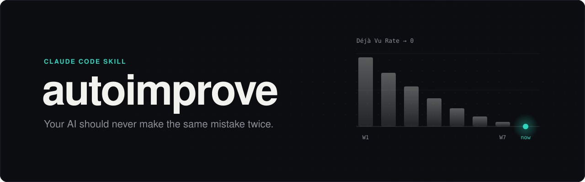
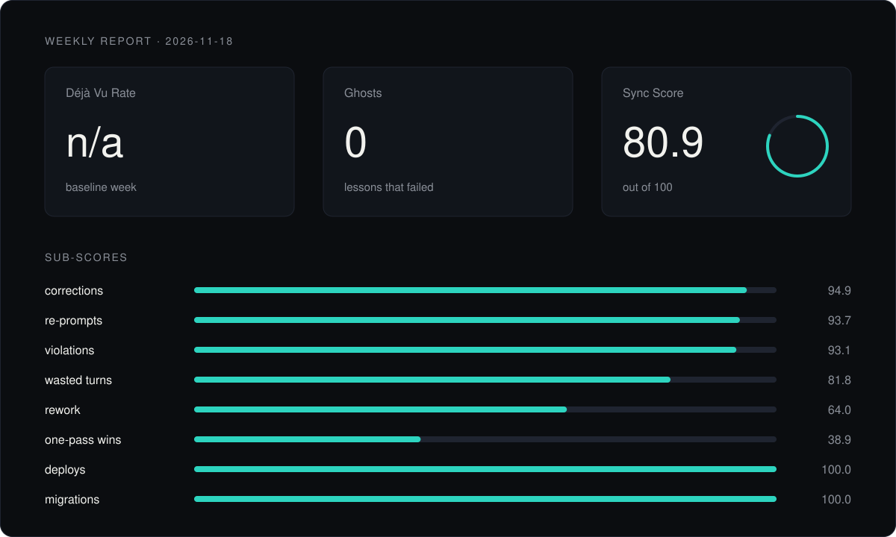
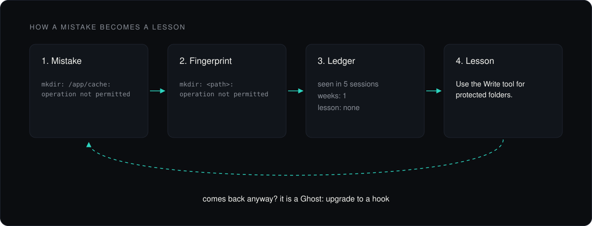
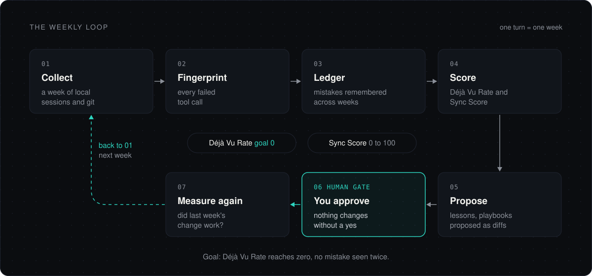

<p align="center">
  <a href="https://github.com/kauxhi/autoimprove/stargazers"></a>
  <a href="https://github.com/kauxhi/autoimprove/commits"></a>
  <a href="LICENSE"></a>
  <a href="SCOREBOARD.md"></a>
  <a href="SCOREBOARD.md"></a>
  <a href="skills/autoimprove/collect.py"></a>
</p>

# autoimprove: a self-improving loop for Claude Code

<br />

## What is autoimprove?

autoimprove is a Claude Code skill that makes Claude auto improve at working with you. Once a week it reviews your own Claude Code sessions and git history, and turns repeated mistakes into lessons.

Most AI tooling measures the model. This measures the working relationship: how often you correct, re-ask and redo. And it checks the thing that matters most over time: whether a mistake, once fixed, stays fixed.

It is a small, self-improving loop that stays on your machine. One script, no dependencies. It proposes changes as diffs you approve, and never edits your instructions by itself.

<br />

## At a glance

<table>
  <tr>
    <td align="left"><b>Weekly report: the two numbers and every sub-score</b></td>
  </tr>
  <tr>
    <td></td>
  </tr>
  <tr>
    <td align="left"><b>From mistake to lesson: fingerprint, ledger, lesson, Ghost</b></td>
  </tr>
  <tr>
    <td></td>
  </tr>
</table>

*The report card shows the author's real baseline week.*

<br />

## Key features

| Area | Highlights |
|:---|:---|
| **Repeat mistakes** | Fingerprints every failed tool call, keeps a ledger across weeks, reports the Déjà Vu Rate and counts Ghosts. |
| **Sync Score** | Eight sub-scores, normalised per active hour. A sub-score that cannot be measured is `n/a`, never guessed. |
| **Lessons** | A one-line rule for each repeat, proposed as an exact diff. Ghosts escalate from prose to hooks. |
| **Playbooks** | Detects repeat tasks and writes known-good steps and traps for work you keep redoing. |
| **Privacy** | Local only. Counts, not content. A private-project filter keeps error text out of fingerprints. |
| **Connectors** | Optional deploy and migration counts feed two more sub-scores. |
| **Scoreboard** | One row per week, public or private. |

<br />

## Get started

```bash
git clone --depth 1 https://github.com/kauxhi/autoimprove && cp -r autoimprove/skills/autoimprove ~/.claude/skills/ && python3 ~/.claude/skills/autoimprove/collect.py --selftest
```

The selftest prints `selftest ok`. Then ask Claude: **run autoimprove**.

- [Configuration](#configuration): the CONFIG block at the top of `collect.py`.
- [The skill file](skills/autoimprove/SKILL.md): the rules, steps and report template Claude follows.
- Weekly scheduling: run it every week (for example Monday 09:00) with Claude Code's scheduled tasks, or a cron line that starts a headless session with the prompt "run autoimprove".

<br />

## The weekly loop



One turn a week: nothing in step 6 changes your setup until you say yes.

<br />

## The two numbers

The goal is Déjà Vu zero.

**Déjà Vu Rate** is the headline. Of this week's failed tool calls, what share has a fingerprint already seen in an earlier week? The goal is 0. Its companion count is **Ghosts**: mistakes that came back even though a written lesson exists for them. A Ghost means the lesson did not work, so it gets upgraded from prose to a hook or a script check.

**Sync Score** (0 to 100) is the weighted mean of sub-scores for how smoothly the week went: corrections, re-prompts, rule violations, wasted turns, rework, one-pass wins, plus deploys and migrations when connector counts are supplied. A sub-score that cannot be measured is `n/a` and drops out of the weights rather than being guessed.

| Sub-score | Weight | Formula (clamped 0 to 100) | Counted as |
|---|---|---|---|
| corrections | 20 | 100 - 20 x count per active hour | prompts opening with "no", "wrong", "I said", "undo", "still broken" and similar, plus interrupts |
| reprompts | 10 | 100 - 40 x count per active hour | a prompt at least 80% similar to an earlier one in the same session |
| violations | 15 | 100 - 10 x count per active hour | assistant messages matching a `BANNED_OUTPUT` regex (n/a when none are set) |
| wasted | 10 | 100 - 5 x count per active hour | failed tool calls, including permission denials |
| rework | 15 | 100 x (1 - rework commits / commits) | your commits titled revert, or titled fix touching a file you changed in the prior 48 hours |
| wins | 15 | 100 x one-pass sessions / sessions | sessions with zero corrections and zero reprompts |
| deploys | 10 | 100 x (1 - failed / total) | optional, from connector counts |
| migrations | 5 | 100 x (1 - fix / total) | optional, from connector counts |

Active hours are the gaps between consecutive events in a session, each capped at 5 minutes.

### How a mistake becomes a lesson

1. **Fingerprint.** A failed tool call is reduced to its first meaningful line, lower-cased, with paths, urls, ids and numbers stripped. `Error: ENOENT: no such file or directory, open '/home/you/app/src/config.ts' (line 42)` becomes `error: enoent: no such file or directory, open '<path>' (line <n>)`.
2. **Ledger.** Each fingerprint gets one entry in `mistakes.json`, which you own:

   ```json
   {
     "error: enoent: no such file or directory, open '<path>' (line <n>)": {
       "tool": "Read",
       "first_seen": "2026-11-11",
       "weeks": ["2026-11-11", "2026-11-18"],
       "total": 7,
       "lesson": "check-path-before-read"
     }
   }
   ```

3. **Lesson.** Any repeat without a lesson gets a one-line rule naming the wrong action and the right one, proposed as a diff to your `CLAUDE.md` or a memory note: *"Do not Read a path guessed from memory; Glob for it first."*
4. **Ghost escalation.** If that fingerprint shows up again after the lesson exists, it is a Ghost. The fix is never a reworded sentence. It becomes a hook or a script check that makes the mistake impossible.

<br />

## Configuration

Edit the CONFIG block at the top of `collect.py`:

| Setting | Default | What it does |
|---|---|---|
| `BANNED_OUTPUT` | `[]` | Regexes that count as a rule violation when an assistant message matches. Empty means the violations sub-score is n/a. |
| `PRIVATE_PROJECTS` | `None` | Regex for project folder names whose error text is never fingerprinted. |
| `EXCLUDE_PROJECTS` | `"observer-sessions"` | Regex for project folders skipped entirely. |
| `TOPICS` | 6 generic topics | Keyword regexes for repeat-task detection (auth-signin, email-sending, deploy, db-migration, payments, file-export). |

<br />

## Privacy

- Local only. The collector reads `~/.claude/projects` and local git, and writes nothing except stdout.
- Counts, not content. The output holds counts, session ids, dates, commit shas and normalised fingerprints. Never prompt text.
- Private-project filter. Folders matching `PRIVATE_PROJECTS` are counted but never fingerprinted.
- The skill's rules forbid quoting transcript text in the report.

<br />

## Scoreboard

The author's own weekly numbers, in public. Full log: [SCOREBOARD.md](SCOREBOARD.md).

| Week ending | Formula | Sync Score | Déjà Vu Rate | Ghosts | corrections | re-prompts | violations | wasted | rework | wins | deploys | migrations | active hours |
|---|---|---|---|---|---|---|---|---|---|---|---|---|---|
| 2026-11-18 | v2 | 80.9 | n/a (baseline) | 0 | 94.9 | 93.7 | 93.1 | 81.8 | 64.0 | 38.9 | 100.0 | 100.0 | 133.9 |

<br />

## Limits and honesty

These are heuristics. Treat the numbers as trends, not verdicts.

- Corrections are keyword matches on the start of a prompt. "No problem, thanks" counts; a polite correction may not.
- Rework is inferred from commit titles. Teams that never write "fix" or "revert" will read high.
- Repeat-task topics are keyword matches, so a topic word used in passing counts.
- Fingerprints can merge two different errors with the same shape, or split one error that prints differently.
- Connector sub-scores are only as good as the counts Claude gathers.

<br />

## FAQ

**Can Claude Code auto improve itself?**
It cannot change its own weights. autoimprove improves the instructions, memory and playbooks Claude reads, and you approve each change.

**Does it send my data anywhere?**
No. It is local only: it reads your local sessions and git history and writes nothing but stdout.

**Does it change my CLAUDE.md automatically?**
No. It only proposes diffs. You decide what to apply.

**How is this different from memory?**
Memory stores facts. autoimprove measures whether mistakes actually stop.

<br />

## Roadmap

- **v3**: the Déjà Vu Rate becomes a scored sub-score once two weeks of ledger exist.

<br />

## Resources

- [skills/autoimprove/SKILL.md](skills/autoimprove/SKILL.md): the skill Claude follows.
- [skills/autoimprove/collect.py](skills/autoimprove/collect.py): the local collector.
- [SCOREBOARD.md](SCOREBOARD.md): the weekly log.
- [examples/report.md](examples/report.md): a sample weekly report.
- [LICENSE](LICENSE): MIT.
