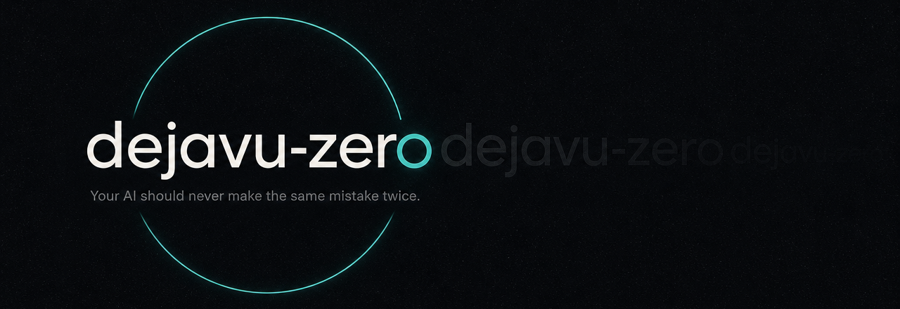
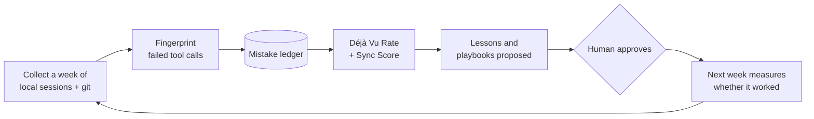

<p align="center">
  
</p>

<p align="center"><b>Your AI should never make the same mistake twice.</b></p>

<p align="center">
  
  
  
  
  
</p>

A Claude Code skill that reviews a week of your own sessions every Monday, scores how well you and Claude work together, and tracks whether Claude repeats a mistake it already made.

## Why

Most AI tooling measures the model.
This measures the working relationship: how often you correct, re-ask, and redo.
And it checks the thing that matters most over time: whether a mistake, once fixed, stays fixed.
One script, no dependencies, nothing leaves your machine.

## The weekly loop



## The two numbers

**Déjà Vu Rate** is the headline. Of this week's failed tool calls, what share has a fingerprint already seen in an earlier week? The goal is 0. Its companion count is **Ghosts**: mistakes that came back even though a written lesson exists for them. A Ghost means the lesson did not work, so it gets upgraded from prose to a hook or a script check.

**Sync Score** (0 to 100) is the weighted mean of sub-scores for how smoothly the week went: corrections, re-prompts, rule violations, wasted turns, rework, one-pass wins, plus deploys and migrations when connector counts are supplied. A sub-score that cannot be measured is `n/a` and drops out of the weights rather than being guessed.

| Sub-score | Weight | Formula (clamped 0 to 100) | Counted as |
|---|---|---|---|
| corrections | 20 | 100 - 20 x count per active hour | prompts opening with "no", "wrong", "I said", "undo", "still broken" and similar, plus interrupts |
| reprompts | 10 | 100 - 40 x count per active hour | a prompt at least 80% similar to an earlier one in the same session |
| violations | 15 | 100 - 10 x count per active hour | assistant messages matching a `BANNED_OUTPUT` regex (n/a when none are set) |
| wasted | 10 | 100 - 5 x count per active hour | failed tool calls, including permission denials |
| rework | 15 | 100 x (1 - rework commits / commits) | your commits titled revert, or titled fix touching a file you changed in the prior 48 hours |
| wins | 15 | 100 x one-pass sessions / sessions | sessions with zero corrections and zero reprompts |
| deploys | 10 | 100 x (1 - failed / total) | optional, from connector counts |
| migrations | 5 | 100 x (1 - fix / total) | optional, from connector counts |

Active hours are the gaps between consecutive events in a session, each capped at 5 minutes.

## How a mistake becomes a lesson

1. **Fingerprint.** A failed tool call is reduced to its first meaningful line, lower-cased, with paths, urls, ids and numbers stripped:

   ```text
   Error: ENOENT: no such file or directory, open '/home/you/app/src/config.ts' (line 42)
   ```
   becomes
   ```text
   error: enoent: no such file or directory, open '<path>' (line <n>)
   ```

2. **Ledger.** Each fingerprint gets one entry in `mistakes.json`, which you own:

   ```json
   {
     "error: enoent: no such file or directory, open '<path>' (line <n>)": {
       "tool": "Read",
       "first_seen": "2026-11-11",
       "weeks": ["2026-11-11", "2026-11-18"],
       "total": 7,
       "lesson": "check-path-before-read"
     }
   }
   ```

3. **Lesson.** Any repeat without a lesson gets a one-line rule naming the wrong action and the right one, proposed as a diff to your `CLAUDE.md` or a memory note: *"Do not Read a path guessed from memory; Glob for it first."*

4. **Ghost escalation.** If that fingerprint shows up again after the lesson exists, it is a Ghost. The fix is never a reworded sentence. It becomes a hook or a script check that makes the mistake impossible.

## Install

```bash
git clone https://github.com/kauxhi/dejavu-zero
cp -r dejavu-zero/skills/dejavu-zero ~/.claude/skills/
python3 ~/.claude/skills/dejavu-zero/collect.py --selftest   # prints: selftest ok
```

Then ask Claude: **"run dejavu zero"**.

Optional: schedule it weekly (for example Monday 09:00) with Claude Code's scheduled tasks, or a cron line that starts a headless session with that prompt.

## Configuration

Edit the CONFIG block at the top of `collect.py`:

| Setting | Default | What it does |
|---|---|---|
| `BANNED_OUTPUT` | `[]` | Regexes that count as a rule violation when an assistant message matches. Empty means the violations sub-score is n/a. |
| `PRIVATE_PROJECTS` | `None` | Regex for project folder names whose error text is never fingerprinted. |
| `EXCLUDE_PROJECTS` | `"observer-sessions"` | Regex for project folders skipped entirely. |
| `TOPICS` | 6 generic topics | Keyword regexes for repeat-task detection (auth-signin, email-sending, deploy, db-migration, payments, file-export). |

## Privacy

- Local only. The collector reads `~/.claude/projects` and local git, and writes nothing except stdout.
- Counts, not content. The output holds counts, session ids, dates, commit shas and normalised fingerprints. Never prompt text.
- Private-project filter. Folders matching `PRIVATE_PROJECTS` are counted but never fingerprinted.
- The skill's rules forbid quoting transcript text in the report.

## Scoreboard

The author's own weekly numbers, in public. Full log: [SCOREBOARD.md](SCOREBOARD.md).

| Week ending | Formula | Sync Score | Déjà Vu Rate | Ghosts | corrections | re-prompts | violations | wasted | rework | wins | deploys | migrations | active hours |
|---|---|---|---|---|---|---|---|---|---|---|---|---|---|
| 2026-11-18 | v2 | 80.9 | n/a (baseline) | 0 | 94.9 | 93.7 | 93.1 | 81.8 | 64.0 | 38.9 | 100.0 | 100.0 | 133.9 |

## Limits and honesty

These are heuristics. Treat the numbers as trends, not verdicts.

- Corrections are keyword matches on the start of a prompt. "No problem, thanks" counts; a polite correction may not.
- Rework is inferred from commit titles. Teams that never write "fix" or "revert" will read high.
- Repeat-task topics are keyword matches, so a topic word used in passing counts.
- Fingerprints can merge two different errors with the same shape, or split one error that prints differently.
- Connector sub-scores are only as good as the counts Claude gathers.

## Roadmap

- **v3**: the Déjà Vu Rate becomes a scored sub-score once two weeks of ledger exist.

## License

MIT. See [LICENSE](LICENSE).
